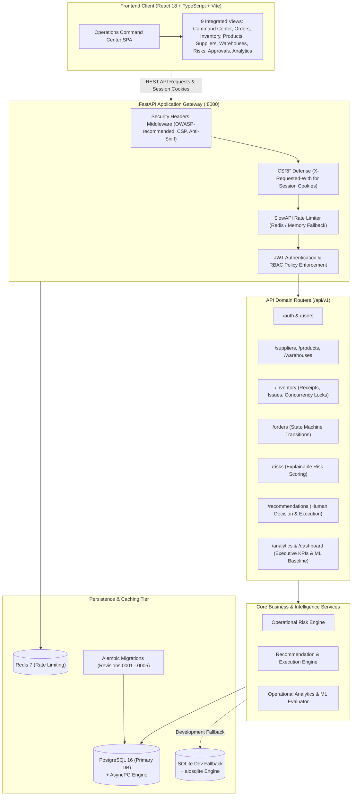
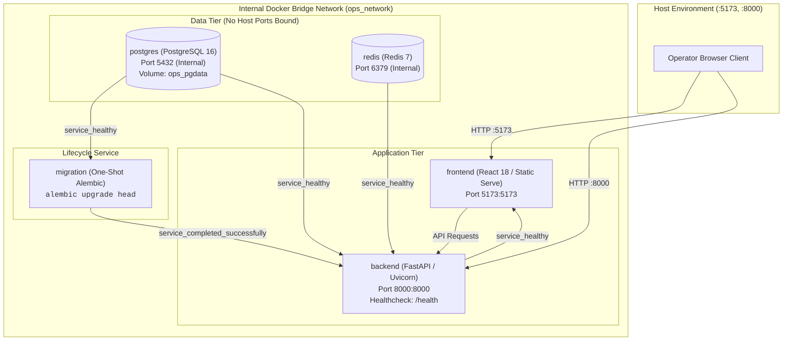

# AI Operations Control Tower

*An enterprise-grade supply chain intelligence, operational risk detection, and human-in-the-loop decision execution platform.*

---

## Table of Contents

- [Overview](#overview)
- [Problem Statement & Core Goals](#problem-statement--core-goals)
- [System Architecture](#system-architecture)
- [Technology Stack](#technology-stack)
- [Core Implemented Features](#core-implemented-features)
- [Interactive Operations Cockpit (Frontend Views)](#interactive-operations-cockpit-frontend-views)
- [Repository Structure](#repository-structure)
- [Local Development Setup (Windows PowerShell)](#local-development-setup-windows-powershell)
- [Environment Configuration](#environment-configuration)
- [Database Architecture & Migrations](#database-architecture--migrations)
- [REST API Reference](#rest-api-reference)
- [Testing, Build & CI/CD Pipeline](#testing-build--cicd-pipeline)
- [Docker Compose Deployment](#docker-compose-deployment)
- [Deployment Status & Infrastructure Verification](#deployment-status--infrastructure-verification)
- [Security & Operational Governance](#security--operational-governance)
- [Known Limitations](#known-limitations)
- [Contribution & Licensing](#contribution--licensing)

---

## Overview

The **AI Operations Control Tower** is a full-stack operations management and decision intelligence system. Built with Python 3.12 (FastAPI), React 18 (TypeScript), PostgreSQL 16, and Redis 7, it addresses critical operational challenges in multi-facility warehousing, supply chain inventory allocation, and order fulfillment.

Rather than relying on uninspected automated execution, the platform implements a governed **Human-in-the-Loop** operational loop:

$$\textbf{Operational Telemetry} \longrightarrow \textbf{Risk Engine} \longrightarrow \textbf{Recommendation} \longrightarrow \textbf{Human Review} \longrightarrow \textbf{Transactional Execution} \longrightarrow \textbf{Audit Log}$$

Every state change—from inventory receipts and threshold adjustments to order lifecycle progression and recommendation approvals—is attributed to an authenticated operator, validated against database-enforced business invariants, and recorded in an append-only audit log.

---

## Problem Statement & Core Goals

### The Problem
Modern supply chains and multi-warehouse networks frequently suffer from:
1. **Data Fragmentation**: Stock balances, vendor reliability, and order statuses reside across disparate databases with inconsistent synchronization.
2. **Delayed Stockout & SLA Detection**: Threshold breaches are identified reactively after backorders occur or dispatches are missed.
3. **Unsafe Automation Risks**: Fully automated inventory mutations can cause stock overdrafts, double-ordering, or stock level divergence.
4. **Lack of Operator Accountability**: State changes frequently lack attributed operator context, auditable logs, and clear decision rationale.

### Engineering Goals
- **Deterministic Risk Intelligence**: Calculate multi-factor risk scores across stockouts, supplier reliability, and delivery bottlenecks using explainable rules.
- **Governed Human Decision Intelligence**: Present ranked operational recommendations with supporting evidence, requiring authorized operator approval before executing transactions.
- **Strict Business Invariant Safeguards**: Guarantee physical invariants (e.g., $quantity\_reserved \le quantity\_on\_hand$, non-negative available stock, valid order state machine transitions) at the database layer.
- **Role-Based Access Control (RBAC)**: Enforce server-side permissions across 4 discrete roles (`ADMIN`, `OPERATIONS_MANAGER`, `ANALYST`, `VIEWER`) using signed JWT access tokens and `HttpOnly` session cookies.
- **Fail-Fast Operational Resilience**: Prevent silent database fallbacks in staging/production, reject development credentials, and provide explicit readiness and diagnostic probes.

---

## System Architecture

The application is structured into decoupled layers with clear separation of concerns:



### Architectural Highlights:
- **Asynchronous I/O Pipeline**: Non-blocking database queries via SQLAlchemy 2.0 async engine and `asyncpg`.
- **Dual-Engine Persistence**: Production requires PostgreSQL 16+; native local development supports automatic persistent SQLite fallback with operational log notices.
- **Idempotency & Concurrency**: Critical stock movements use database row-level locking (`with_for_update()`) and caller-supplied UUID idempotency keys to eliminate race conditions and duplicate receipts/issues.
- **Dynamic Connection Normalization**: Backend automatically parses connection strings to support cloud PostgreSQL drivers (including Neon TLS/SSL parameters) while stripping unsupported libpq query arguments for asyncpg.

---

## Technology Stack

| Layer | Component | Version / Specification | Rationale & Usage |
| :--- | :--- | :--- | :--- |
| **Backend** | Python | `3.12.x` | Modern asynchronous CPython runtime |
| | FastAPI | `>=0.115, <1.0` | High-performance asynchronous API framework with OpenAPI schema generation |
| | Pydantic / Settings | `>=2.5, <3.0` | Strict data validation, schema serialization, and fail-fast environment parsing |
| | Uvicorn | `>=0.30, <1.0` | ASGI production web server |
| **Database & ORM** | PostgreSQL | `16-alpine` | Primary ACID relational database |
| | SQLAlchemy | `>=2.0, <3.0` | Asynchronous ORM and SQL abstraction engine |
| | asyncpg | `>=0.29, <1.0` | High-throughput asynchronous PostgreSQL driver |
| | aiosqlite | `>=0.20, <1.0` | Async SQLite driver for zero-dependency local development |
| | Alembic | `>=1.13, <2.0` | Database schema migrations with linear revision tracking |
| **Security & Caching**| Bcrypt | `>=4.0, <6.0` | Salted password hashing (minimum 12 rounds) |
| | PyJWT | `>=2.8, <3.0` | Signed access tokens with custom claims |
| | SlowAPI / Redis | `>=0.1.9` / `7-alpine` | Endpoint rate limiting with Redis storage or in-memory fallback |
| **Frontend** | React | `18.3.1` | Declarative UI framework |
| | TypeScript | `5.7.2` | Compile-time type safety across all operational schemas |
| | Vite | `6.0.1` | Build tool and development server |
| | Lucide React | `0.468.0` | Consistent iconography |
| | Vanilla CSS | Custom Design System | High-performance, zero-framework CSS (dark operations theme) |
| **Testing & CI** | Pytest / Asyncio | `>=8.0` / `>=0.23` | Asynchronous test runner with isolated database fixtures |
| | HTTPX | `>=0.27, <1.0` | Asynchronous HTTP client for API regression testing |
| | GitHub Actions | Ubuntu Runner | Multi-container CI testing and bundle build verification |

---

## Core Implemented Features

### 1. Explainable Operational Risk Engine (`/api/v1/risks`)
- Evaluates operational state across products, facilities, suppliers, and dispatches.
- Produces deterministic risk signals classified by severity: `CRITICAL`, `HIGH`, `MEDIUM`, and `LOW`.
- Identifies:
  - **Stockout & Low-Stock Risk**: Available inventory vs. safety stock and reorder thresholds.
  - **Supplier SLA Vulnerability**: Low historical reliability scores (< 0.85) and long lead times.
  - **Fulfillment Bottlenecks**: Active orders past expected delivery dates.
  - **Facility Imbalances**: Products depleted in one warehouse while surplus exists in another.
- Every detected risk includes a plain-English explanation, triggered business rules, and suggested remedial actions.

### 2. Human-in-the-Loop Decision Intelligence (`/api/v1/recommendations`)
- Automatically transforms detected operational risks into deduplicated recommendations (`STOCK_REORDER`, `INVENTORY_IMBALANCE`, `SUPPLIER_RISK`, `EXPEDITE_ORDER`).
- Enforces an approval workflow:
  - `PENDING`: Initial state awaiting operator evaluation.
  - `APPROVED` / `REJECTED`: Decision recorded with operator email, timestamp, and mandatory audit comment (`RECOMMENDATION_DECIDE` permission).
  - `EXECUTED`: Transactionally executed into inventory receipts or orders (`DATA_MANAGE` permission).
- Execution checks target entity validity immediately prior to mutation, preventing stale operations.

### 3. Business Invariant Safeguards & Concurrency Control
- **Negative-Stock Prevention**: Row-level locking (`with_for_update()`) during stock issues ensures available balance ($on\_hand - reserved$) cannot drop below zero.
- **Idempotency Key Deduplication**: Stock receipts and issues require an idempotency key; duplicate submissions are detected and rejected.
- **Server-Calculated Financials**: Client-submitted order prices are rejected. Line item costs and total amounts are strictly derived from master product catalog values using `Numeric(12, 2)` decimal precision.
- **Finite State Machine for Orders**: Enforces strictly valid lifecycle transitions:
  $$\text{PENDING} \longrightarrow \text{PROCESSING} \longrightarrow \text{SHIPPED} \longrightarrow \text{DELIVERED}$$
  or $\text{CANCELLED}$. Terminal states (`DELIVERED`, `CANCELLED`) cannot be modified.
- **Safe Relational Deletions**: Deleting suppliers or products is blocked if active inventory or purchase order items reference them. Soft deactivation (`is_active = false`) is provided instead.

### 4. Operational Analytics & Supervised ML Delay Baseline (`/api/v1/analytics`)
- **Executive KPI Aggregation**: Aggregated totals for orders, inventory valuations, fulfillment rates, and critical risks across selectable timeframes (`7d`, `30d`, `90d`, `all`, or custom ISO date ranges).
- **Time-Series Trends**: Daily order volumes, delivered counts, delayed dispatch rates, and revenues.
- **Cost-Weighted Valuations**: Breakdown of inventory value across warehouses and product categories.
- **Supervised ML Delay Baseline**: Provides an interpretable supervised baseline predicting order delay risk using priority weights and delivery dates:
  - Enforces a strict 70/30 chronological temporal split (preventing lookahead bias).
  - **Data-Sufficiency Gating**: If qualifying historical orders with delivery dates are below 20, the system reports an explicit `insufficient_data` status with requirements rather than fabricating synthetic training labels.

### 5. Multi-Role RBAC & Session Security (`/api/v1/auth`, `/api/v1/users`)
Server-side permissions matrix enforced via FastAPI dependency guards:

| Role | Permitted Actions | Restricted Actions |
| :--- | :--- | :--- |
| **ADMIN** | User administration, decision approvals, data management, analytics, dashboard | None (Full administrative privileges) |
| **OPERATIONS MANAGER** | Recommendation approval/rejection, inventory mutations, order status updates, analytics, dashboard | User administration |
| **ANALYST** | Risk intelligence detection, operational analytics, dashboard read | Recommendation decisions, data mutations, user administration |
| **VIEWER** | Core dashboard summary and read-only inspection | Risk detection, recommendation decisions, data mutations, user administration |

- **Session Security**: Login endpoint issues signed JWT access tokens and sets an `HttpOnly`, `SameSite=Lax` cookie (`access_token`) to protect browser clients against token exfiltration via XSS.
- **CSRF Mitigation**: State-changing requests authenticated via session cookies require the custom `X-Requested-With: XMLHttpRequest` header.

### 6. Fail-Fast Reliability & Diagnostics
- **Production Assertion Checks**: Backend aborts startup immediately (`RuntimeError`) if configured for production/staging while `SECRET_KEY` is weak/default, `ALLOW_SQLITE_FALLBACK=true`, `ENABLE_DEMO_LOGINS=true`, or primary PostgreSQL connectivity fails.
- **Operational Probes**:
  - `GET /health`: Lightweight process liveness check.
  - `GET /ready`: Dependency readiness probe (returns HTTP 200 when operational; HTTP 503 if primary DB is down and fallback is disabled).
  - `GET /health/diagnostics`: Sanitized diagnostics reporting active backend engine (`postgresql` vs `sqlite`), pool sizing, and security flags without leaking secrets.

---

## Interactive Operations Cockpit (Frontend Views)

The React 18 TypeScript frontend provides an operations cockpit organized into nine functional views:

1. **Executive Command Center (`command-center`)**: Operational overview featuring real-time KPI cards, time-series order and delayed dispatch charts, active stockout alerts, and risk summaries. Includes dynamic date range selectors (`7d`, `30d`, `90d`, `all`, custom ISO dates).
2. **Orders Management (`orders`)**: Searchable and filterable order roster. Includes a multi-item order creation modal with live subtotal computations, line-item itemization, and state machine progression buttons (`PENDING` $\rightarrow$ `PROCESSING` $\rightarrow$ `SHIPPED` $\rightarrow$ `DELIVERED`).
3. **Inventory & Movements (`inventory`)**: Toggle between live warehouse stock balances and the stock movement audit history. Features modal forms for inbound Stock Receipts (PO) and outbound Stock Issues (Dispatch) with real-time UUID idempotency key generation.
4. **Product Catalog (`products`)**: Master SKU directory with category filters, sorting by price or creation date, active/inactive toggles, and new product creation modals with supplier linkage.
5. **Suppliers Directory (`suppliers`)**: Supply chain vendor management showing contact records, lead-time tracking, reliability score indicators, and safe deactivation controls.
6. **Warehouses (`warehouses`)**: Facility roster displaying active distribution centers, location metadata, capacity limits, and utilization metrics.
7. **Risk Intelligence (`risks`)**: Listing of detected operational risk signals with severity chips, category badges, rule explanations, and suggested remediation recommendations.
8. **Decision Approvals (`approvals`)**: Governance dashboard where operators review pending recommendations, inspect evidence, record approval or rejection comments, and trigger transactional execution into inventory or orders.
9. **Operational Analytics (`analytics`)**: Deep-dive analytics console displaying cost-weighted inventory valuations by facility and category, fulfillment cycle performance, supplier reliability scores, and the transparent ML delay baseline evaluation.

---

## Repository Structure

```
ai-operations-control-tower/
├── .env.example                     # Environment configuration template
├── .github/
│   └── workflows/
│       └── ci.yml                   # GitHub Actions multi-container CI pipeline
├── .gitignore                       # Git exclusions (credentials, DBs, bundles)
├── .python-version                  # Python runtime version pin (3.12)
├── docker-compose.yml               # Multi-container orchestration (staging/prod)
├── docker-compose.override.yml.example # Opt-in localhost port mapping for dev tools
├── README.md                        # Project documentation
│
├── backend/                         # FastAPI backend application
│   ├── alembic/                     # Database migrations
│   │   ├── env.py                   # Async Alembic execution environment
│   │   └── versions/                # Linear migration scripts (0001 - 0005)
│   ├── alembic.ini                  # Migration engine configuration
│   ├── app/
│   │   ├── api/
│   │   │   ├── deps.py              # Dependency injection (DB session, RBAC guards)
│   │   │   └── v1/                  # Domain API routers (auth, orders, inventory, etc.)
│   │   ├── core/                    # Core configuration, security, database, and rate limiting
│   │   ├── models/                  # SQLAlchemy ORM database models (11 domain entities)
│   │   ├── repositories/            # Data access layer & business invariants
│   │   ├── schemas/                 # Pydantic v2 validation and response models
│   │   ├── services/                # Business engines (risk, recommendation, analytics)
│   │   └── main.py                  # Application entry point, lifespan, & middleware
│   ├── tests/                       # Pytest asynchronous test suite (18 test files)
│   ├── Dockerfile                   # Multi-stage non-root backend image
│   └── requirements.txt             # Pinned backend dependencies
│
└── frontend/                        # React 18 TypeScript single-page application
    ├── src/
    │   ├── App.tsx                  # Command Center UI & 9 operational tab views
    │   ├── main.tsx                 # React DOM mount point
    │   └── styles.css               # Production dark operations design system
    ├── Dockerfile                   # Multi-stage build and static serve image
    ├── package.json                 # Frontend dependencies and npm scripts
    ├── tsconfig.json                # Strict TypeScript configuration
    └── vite.config.ts               # Vite bundler configuration
```

---

## Local Development Setup (Windows PowerShell)

> [!NOTE]
> All commands below assume you are working in the inner project repository directory containing the `backend/` and `frontend/` folders.

### 1. Prerequisites
- **Python**: 3.12.x installed (`python --version`)
- **Node.js**: 20.x or 22.x LTS installed (`node --version`, `npm --version`)
- **Git**: Installed and available in PATH
- *(Optional)* **PostgreSQL 16+** & **Redis 7+**: If not present locally, the backend automatically activates its persistent SQLite development database (`backend/ops_control.db`) and in-memory rate limiting.

### 2. Backend Setup
Open a Windows PowerShell terminal in the repository root (`ai-operations-control-tower`):

```powershell
# Working Directory: Repository root (`ai-operations-control-tower`)

# 1. Create and activate a Python virtual environment
python -m venv .venv
.\.venv\Scripts\Activate.ps1

# 2. Install backend dependencies
pip install -r backend/requirements.txt

# 3. Copy the environment configuration template
Copy-Item .env.example .env

# 4. Navigate into backend and start the FastAPI development server
# (Runs with persistent SQLite fallback if local PostgreSQL is absent)
Set-Location backend
$env:PYTHONPATH="."
python -m uvicorn app.main:app --reload --host 0.0.0.0 --port 8000
```

Verified local backend URLs:
- **Interactive OpenAPI Documentation**: [http://localhost:8000/docs](http://localhost:8000/docs)
- **Liveness Probe**: [http://localhost:8000/health](http://localhost:8000/health)
- **Readiness Probe**: [http://localhost:8000/ready](http://localhost:8000/ready)
- **Sanitized Diagnostics**: [http://localhost:8000/health/diagnostics](http://localhost:8000/health/diagnostics)

### 3. Frontend Setup
Open a second Windows PowerShell terminal in the repository root (`ai-operations-control-tower`):

```powershell
# Working Directory: Repository root (`ai-operations-control-tower`)

# 1. Navigate to the frontend directory
Set-Location frontend

# 2. Install frontend dependencies
npm install

# 3. Launch the Vite development server
npm run dev
```

- **Operations Control Tower UI**: [http://localhost:5173](http://localhost:5173)

---

## Environment Configuration

Configuration is managed via environment variables and loaded by Pydantic-Settings in `backend/app/core/config.py`. Use `.env.example` as a template:

| Variable Name | Default (Development) | Purpose & Validation Rules |
| :--- | :--- | :--- |
| `APP_ENV` | `development` | Target environment: `development`, `staging`, or `production`. |
| `SECRET_KEY` | *(Dev default)* | Cryptographic signing key. In staging/production, must be $\ge 32$ random characters. |
| `ALLOW_SQLITE_FALLBACK`| `true` | Permits SQLite fallback in development. **Must be `false` in staging/production.** |
| `ENABLE_DEMO_LOGINS` | `true` | Shows quick-evaluator login buttons. **Must be `false` in staging/production.** |
| `POSTGRES_USER` | `ops` | PostgreSQL username. |
| `POSTGRES_PASSWORD` | *(Placeholder)* | PostgreSQL password. |
| `POSTGRES_DB` | `ops_control` | PostgreSQL database name. |
| `DATABASE_URL` | `postgresql+asyncpg://...` | Asynchronous SQLAlchemy connection string. |
| `REDIS_URL` | `redis://localhost:6379/0` | Connection string for distributed rate limiting. |
| `CORS_ORIGINS` | `http://localhost:5173,...` | Comma-separated list of allowed browser origins. |
| `ALLOWED_HOSTS` | `*` | Allowed HTTP Host headers (`*` permitted in development only). |
| `ACCESS_TOKEN_EXPIRE_MINUTES` | `30` | Access token expiration lifetime in minutes. |
| `COOKIE_SECURE` | `false` | Requires HTTPS for session cookies (`true` enforced in staging/production). |
| `COOKIE_SAMESITE` | `lax` | SameSite cookie policy attribute (`lax` or `strict`). |
| `VITE_API_URL` | `http://localhost:8000/api/v1` | Base URL used by the frontend client. |
| `VITE_ENABLE_DEMO_LOGINS`| `true` | Frontend flag to toggle demo login helper chips. |

> [!CAUTION]
> Never commit `.env` or real secrets to version control. Production and staging deployments must supply cryptographically random credentials via secure environment variables or vault providers.

---

## Database Architecture & Migrations

### Dual-Engine Strategy
- **Development**: If a live PostgreSQL connection is unreachable, the system activates an isolated persistent SQLite database (`backend/ops_control.db`) via `aiosqlite`, printing an operational notice.
- **Staging / Production**: The backend enforces `ALLOW_SQLITE_FALLBACK=false`. Startup immediately halts with a fatal exception (`RuntimeError`) if PostgreSQL is unavailable, preventing silent database divergence.

### Linear Migration Chain
Database schemas are versioned with Alembic under `backend/alembic/versions`:

| Revision ID | Name / Description | Applied Schema Changes |
| :--- | :--- | :--- |
| `0001` | `0001_initial_schema` | Core tables: `users`, `suppliers`, `products`, `warehouses`, `inventory`, `orders`, `order_items`, `audit_logs`. |
| `0002` | `0002_update_user_roles` | Role normalization and index constraints. |
| `0003` | `0003_add_stock_movements` | Adds `stock_movements` ledger for receipts, issues, and adjustments. |
| `0004` | `0004_add_recommendations` | Adds `recommendations` table for decision intelligence proposals. |
| `0005` | `0005_analytics_indexes` | Composite performance indexes on orders, inventory, and status fields. |

### Running Migrations (PowerShell)
To inspect or execute database migrations, ensure your virtual environment is activated and run Alembic from the `backend/` directory (where `alembic.ini` is located):

```powershell
# Working Directory: Repository root (`ai-operations-control-tower`)

# 1. Activate the Python virtual environment
.\.venv\Scripts\Activate.ps1

# 2. Navigate to the backend directory
Set-Location backend

# 3. View current migration head
alembic current

# 4. Apply all migrations to the latest revision
alembic upgrade head

# 5. Generate offline SQL preview without modifying the database
alembic upgrade head --sql
```

---

## REST API Reference

The backend exposes **56 HTTP operations across 43 unique paths**, organized by domain:

### 1. System & Operational Diagnostics
- `GET /health` — Liveness probe (public).
- `GET /ready` — Readiness probe; returns HTTP 200 when database dependencies are operational, or HTTP 503 if unavailable.
- `GET /health/diagnostics` — Sanitized diagnostics detailing active database backend, connection pool status, and security parameters without exposing secrets.

### 2. Authentication & User Administration
- `POST /api/v1/auth/register` — Validates email and password policy, hashes password via Bcrypt, and registers a user.
- `POST /api/v1/auth/login` — Verifies credentials, sets an `HttpOnly` session cookie, and returns signed JWT access token.
- `POST /api/v1/auth/logout` — Synchronously clears session cookies.
- `GET /api/v1/auth/config` — Retrieves public client authentication configuration.
- `GET /api/v1/auth/me` — Returns authenticated user profile and resolved permissions.
- `GET /api/v1/users` — Lists all registered accounts (`USER_MANAGE` / Admin only).
- `PATCH /api/v1/users/{id}` — Updates role or active status (`USER_MANAGE` / Admin only).

### 3. Operational Risks & Recommendations
- `GET /api/v1/risks` — Detects deterministic operational risks across stockouts, suppliers, and orders (`ANALYTICS_READ`).
- `GET /api/v1/recommendations` — Scans live risks and returns deduplicated recommendations (`DASHBOARD_READ`).
- `POST /api/v1/recommendations/{id}/approval` — Records human approval or rejection decision with comment and audit log entry (`RECOMMENDATION_DECIDE`).
- `POST /api/v1/recommendations/{id}/execute` — Transactionally executes an approved recommendation into operational inventory or order changes (`DATA_MANAGE`).

### 4. Operational Analytics & Executive Intelligence
- `GET /api/v1/dashboard/summary` — Standard dashboard summary snapshot (`DASHBOARD_READ`).
- `GET /api/v1/dashboard/executive` — Live consolidated executive dashboard intelligence with date range presets (`DASHBOARD_READ`).
- `GET /api/v1/analytics/executive` — Consolidated operational intelligence endpoint (`DASHBOARD_READ`).
- `GET /api/v1/analytics/summary` — Operational KPI statistics across products, orders, and warehouses (`DASHBOARD_READ`).
- `GET /api/v1/analytics/orders/trend` — Daily order volumes, delivered counts, delayed counts, and revenues (`DASHBOARD_READ`).
- `GET /api/v1/analytics/orders/status-distribution` — Order status breakdown with counts, percentages, and valuations (`DASHBOARD_READ`).
- `GET /api/v1/analytics/inventory/valuation` — Cost-weighted valuation breakdown across warehouses and categories (`DASHBOARD_READ`).
- `GET /api/v1/analytics/inventory/low-stock` — Lists inventory items currently at or below reorder threshold (`DASHBOARD_READ`).
- `GET /api/v1/analytics/fulfillment` — On-time delivery rate and cycle days from genuine timestamps (`DASHBOARD_READ`).
- `GET /api/v1/analytics/suppliers` — Supplier reliability ratings and SKU allocation counts (`DASHBOARD_READ`).
- `GET /api/v1/analytics/ml-evaluation` — Evaluates supervised delay prediction baseline with chronological split and sample-size gating (`ANALYTICS_READ`).

### 5. Master Catalog & Facilities
- `GET`, `POST` `/api/v1/suppliers` — List and create supply chain vendors (`DASHBOARD_READ` for read / `DATA_MANAGE` for write).
- `GET`, `PATCH`, `DELETE` `/api/v1/suppliers/{id}` — Retrieve, update, or safely delete vendor records (`DASHBOARD_READ` / `DATA_MANAGE`).
- `POST /api/v1/suppliers/{id}/deactivate` — Safely deactivate supplier without breaking historical relations (`DATA_MANAGE`).
- `GET`, `POST` `/api/v1/products` — List and create catalog products with unique SKU enforcement (`DASHBOARD_READ` / `DATA_MANAGE`).
- `GET`, `PATCH`, `DELETE` `/api/v1/products/{id}` — Retrieve, update, or safely delete catalog items (`DASHBOARD_READ` / `DATA_MANAGE`).
- `POST /api/v1/products/{id}/deactivate` — Safely deactivate product (`DATA_MANAGE`).
- `GET`, `POST` `/api/v1/warehouses` — List and create distribution center facilities (`DASHBOARD_READ` / `DATA_MANAGE`).
- `GET`, `PATCH`, `DELETE` `/api/v1/warehouses/{id}` — Retrieve, update, or safely delete warehouse records (`DASHBOARD_READ` / `DATA_MANAGE`).
- `POST /api/v1/warehouses/{id}/deactivate` — Safely deactivate warehouse (`DATA_MANAGE`).

### 6. Inventory & Order Operations
- `GET /api/v1/inventory` — Paginated stock balances across warehouses with low-stock filters (`DASHBOARD_READ`).
- `GET /api/v1/inventory/by-location` — Stock balance for a specific product and facility pair (`DASHBOARD_READ`).
- `GET /api/v1/inventory/movements` — Audit log of stock movements tracking receipts, issues, and adjustments (`DASHBOARD_READ`).
- `GET`, `PATCH` `/api/v1/inventory/{id}` — Retrieve stock balance (`DASHBOARD_READ`) or update reorder threshold (`DATA_MANAGE`). Direct balance overwrite is forbidden.
- `POST /api/v1/inventory/receipt` — Inbound stock receipt with row-level lock and idempotency key (`DATA_MANAGE`).
- `POST /api/v1/inventory/issue` — Outbound stock dispatch with overdraft prevention (`DATA_MANAGE`).
- `GET`, `POST` `/api/v1/orders` — List orders (`DASHBOARD_READ`) and create purchase orders with server-calculated totals (`DATA_MANAGE`).
- `GET`, `PATCH` `/api/v1/orders/{id}` — Retrieve order details (`DASHBOARD_READ`) or update non-financial metadata on non-terminal orders (`DATA_MANAGE`).
- `PATCH`, `POST` `/api/v1/orders/{id}/status` — Enforce order state machine transitions (`DATA_MANAGE`).

---

## Testing, Build & CI/CD Pipeline

### Automated Test Suite
The backend includes **111 collected tests** across 18 test files covering models, repositories, business invariants, security controls, and API contracts.

To run the test suite locally in PowerShell:

```powershell
# Working Directory: Repository root (`ai-operations-control-tower`)

# 1. Activate the Python virtual environment
.\.venv\Scripts\Activate.ps1

# 2. Set PYTHONPATH and execute pytest
$env:PYTHONPATH="backend"
python -m pytest backend/tests -v
```

#### Test Execution Status:
- **Offline Development Mode (SQLite)**: **109 passed**, **2 skipped**, 0 failed (executed in ~18 seconds). Isolated test fixtures use in-memory SQLite (`sqlite+aiosqlite:///:memory:`) with zero disk mutation.
- **Skipped Integration Tests (2)**: `test_live_postgres_connectivity` and `test_live_postgres_schema_creation_and_transaction_rollback` in `backend/tests/test_postgres_integration.py`. These tests require a reachable PostgreSQL test instance with valid credentials in `DATABASE_URL` and cleanly skip in local environments where PostgreSQL is not running.
- **Automated CI Validation**: In GitHub Actions (`.github/workflows/ci.yml`), attached `postgres:16-alpine` and `redis:7-alpine` service containers execute these 2 live integration tests alongside the offline test suite.

### Frontend Production Build
To validate TypeScript types and compile optimized production assets:

```powershell
# Working Directory: Repository root (`ai-operations-control-tower`)

# 1. Navigate to the frontend directory
Set-Location frontend

# 2. Compile TypeScript and generate the production bundle
npm run build
```
The compiled bundle is generated into `frontend/dist/`.

### GitHub Actions Continuous Integration
The CI pipeline defined in `.github/workflows/ci.yml` runs automatically on pushes and pull requests:
1. **Backend Job**: Launches live `postgres:16-alpine` and `redis:7-alpine` service containers on Ubuntu, installs dependencies, runs the isolated unit test suite, and executes the live PostgreSQL integration and migration test suite.
2. **Frontend Job**: Sets up Node.js 22, installs dependencies via `npm ci`, and executes `npm run build` to verify zero TypeScript compilation errors.

---

## Docker Compose Deployment

The repository includes a production/staging multi-container orchestration specification in `docker-compose.yml`:



### Key Deployment Characteristics:
- **Zero Host Database Exposure**: Database ports (`5432` and `6379`) are isolated within the internal Docker bridge network and not bound to host interfaces.
- **Deterministic Migration Gate**: Alembic migrations run in an isolated one-shot `migration` container. The backend service will not start until migrations complete successfully (`condition: service_completed_successfully`).
- **Non-Root Execution**: Backend runs as unprivileged user `appuser` (UID 1000); frontend runtime runs as `USER node`.
- **Healthchecks**: Integrated healthchecks on Postgres (`pg_isready`), Redis (`redis-cli ping`), Backend (`curl /health`), and Frontend (`wget /`).

### Launching with Docker Compose (PowerShell)
Ensure Docker Engine and Docker Compose are installed and running:

```powershell
# Working Directory: Repository root (`ai-operations-control-tower`)

# 1. Copy the environment configuration template if .env does not exist
Copy-Item .env.example .env

# 2. Build and launch all services in detached mode
docker compose up -d --build

# 3. Inspect container logs in real time
docker compose logs -f

# 4. Stop and remove containers when finished
docker compose down
```

*For local database administration tools, copy `docker-compose.override.yml.example` to `docker-compose.override.yml` to bind database ports strictly to `127.0.0.1` (loopback only).*

---

## Deployment Status & Infrastructure Verification

To maintain technical accuracy, the system distinguishes between **currently reachable live cloud endpoints**, **native local development**, and **containerized staging infrastructure**:

### 1. Live Cloud Deployment (Render Web Services)
The application is deployed on **Render** across decoupled frontend and backend services (verified operational on **October 27, 2026**):

| Component | Endpoint URL | Verified Status (Oct 27, 2026) | Details & Observations |
| :--- | :--- | :--- | :--- |
| **Frontend Application** | [https://ai-operations-control-tower.onrender.com](https://ai-operations-control-tower.onrender.com/) | **Reachable (HTTP 200)** | Static web service serving compiled React 18 / Vite production SPA assets. |
| **Backend API Service** | [https://ai-operations-control-tower-backend.onrender.com](https://ai-operations-control-tower-backend.onrender.com/) | **Reachable (HTTP 200)** | FastAPI service running Uvicorn on Python 3.12 with security headers and CSP. |
| **Interactive API Docs** | [https://ai-operations-control-tower-backend.onrender.com/docs](https://ai-operations-control-tower-backend.onrender.com/docs) | **Reachable (HTTP 200)** | Interactive Swagger UI documentation with live OpenAPI schema. |

#### Live Probe Diagnostics (Verified October 27, 2026):
- **Liveness (`GET /health`)**: Returns HTTP 200:
  ```json
  {"status": "ok", "service": "operations-control-tower", "environment": "production"}
  ```
- **Readiness & Database Dependency (`GET /ready`)**: Returns HTTP 200:
  ```json
  {
    "status": "ready",
    "environment": "production",
    "backend": "postgresql",
    "fallback_active": false,
    "dependencies": {
      "database": "connected",
      "backend": "postgresql",
      "rate_limiter": "memory",
      "database_error": null
    }
  }
  ```

#### Operational Notes & Free-Tier Characteristics:
- **Cloud Database Connection**: The live backend connects to an external PostgreSQL database using SQLAlchemy's asynchronous engine (`asyncpg`) with automatic TLS/SSL normalization.
- **Rate Limiting**: Rate limiting in the current Render environment operates using process-local in-memory tracking (`"rate_limiter": "memory"`).
- **Free-Tier Inactivity Spin-Down**: Render free web services automatically spin down during periods of inactivity. An initial request after dormancy may experience a cold-start delay (typically 30–60 seconds) while the instance resumes.

### 2. Local Native Development (Windows 11)
- Verified locally on native Windows 11 PowerShell using Python 3.12.6 and Node.js 22.14.0.
- When local PostgreSQL or Redis services are not running, the application safely activates its persistent local SQLite database (`backend/ops_control.db`) and in-memory rate limiting.

### 3. Containerized Multi-Service Staging (Docker Compose)
- Fully specified in `docker-compose.yml` with isolated internal bridge networking across 5 services: PostgreSQL 16, Redis 7, an isolated one-shot Alembic migration runner, the FastAPI backend, and the static frontend web server.
- Staging-hardened: no database ports are exposed to public network interfaces by default. Local host-port inspection requires explicit opt-in via `docker-compose.override.yml.example`.

---

## Security & Operational Governance

The application incorporates defense-in-depth architectural safeguards:

1. **Security Headers**: Applied to all HTTP API responses via custom middleware (`backend/app/main.py`):
   - `X-Content-Type-Options: nosniff` — Prevents MIME-type sniffing by enforcing declared content types.
   - `X-Frame-Options: DENY` — Protects against clickjacking attacks by forbidding rendering within frames or iframes.
   - `X-XSS-Protection: 0` — Explicitly disables the deprecated, vulnerable browser XSS auditor in favor of modern CSP rules.
   - `Referrer-Policy: strict-origin-when-cross-origin` — Restricts cross-origin referrer leakage on non-HTTPS or external navigations.
   - `Content-Security-Policy` — Restricts script, style, font, image, connect, frame-ancestors (`'none'`), base-uri, and form-action directives.
2. **Custom Header CSRF Defense**: Requests authenticated via session cookies that perform mutations (`POST`, `PATCH`, `DELETE`) require the `X-Requested-With` header, mitigating cross-site request forgery in browser clients.
3. **Redacted Structured Logging**: HTTP middleware logs method, path, status, and duration while strictly stripping Authorization headers, credentials, cookies, and sensitive payload bodies.
4. **Sanitized Diagnostics**: The `/health/diagnostics` endpoint reports operational status and connection pool parameters without revealing database passwords, private tokens, or file paths.

> [!IMPORTANT]
> *Disclaimer*: These security controls follow established modern web engineering best practices. They have not undergone an external third-party penetration test or SOC2/ISO compliance audit.

---

## Known Limitations

- **SQLite Concurrency in Local Development**: When running with local SQLite fallback, database writes are serialized by SQLite's single-writer locking. High concurrent write workloads require PostgreSQL.
- **Rate Limiter Storage**: When Redis is unavailable (or in single-instance cloud free-tier deployments), rate limiting falls back to process-local in-memory storage. Multi-worker production clusters require a live Redis instance to share rate-limit counters across workers.
- **Machine Learning Scope**: The delay estimation model is an interpretable supervised baseline calibrated on delivery dates and priority weights. It transparently gates evaluation when operational records are under 20 samples and does not replace complex deep-learning dispatch algorithms.
- **Live PostgreSQL Integration Tests**: Require an external, accessible PostgreSQL instance with valid credentials matching `DATABASE_URL`; otherwise, integration tests are skipped cleanly during local test runs.

---

## Contribution & Licensing

### Contribution Workflow
1. Fork the repository and create a feature branch:
   ```powershell
   # Working Directory: Repository root (`ai-operations-control-tower`)
   git checkout -b feature/operational-enhancement
   ```
2. Verify all backend tests pass locally from the repository root:
   ```powershell
   # Working Directory: Repository root (`ai-operations-control-tower`)
   $env:PYTHONPATH="backend"
   python -m pytest backend/tests -v
   ```
3. Verify the frontend compiles without TypeScript or build errors:
   ```powershell
   # Working Directory: Repository root (`ai-operations-control-tower`)
   Set-Location frontend
   npm run build
   Set-Location ..
   ```
4. Verify working tree status and ensure no untracked files or secrets are staged:
   ```powershell
   # Working Directory: Repository root (`ai-operations-control-tower`)
   git status --short
   ```
5. Submit a descriptive Pull Request referencing the related issue or enhancement proposal.

### License & Intellectual Property
All code and architectural assets in this repository are maintained by the project author. No open-source license is granted or implied without explicit written documentation from the repository owner.
